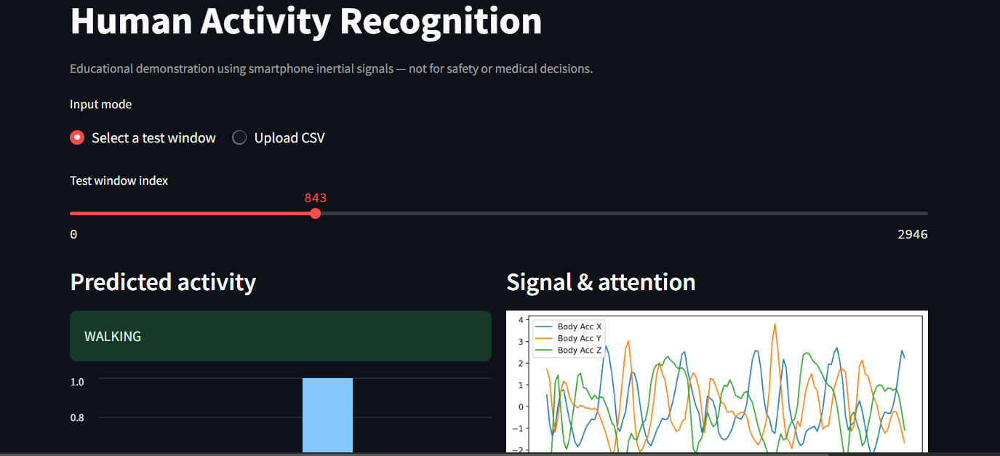

# Human Activity Recognition (HAR)

A deep learning project that recognizes six human activities from smartphone motion sensors using a custom Bidirectional LSTM and Temporal Attention model implemented in PyTorch.

## Activities Recognized
- Walking
- Walking Upstairs
- Walking Downstairs
- Sitting
- Standing
- Laying

## Model Architecture
- Custom RNN Cell
- Custom LSTM Cell
- LSTM Sequence Implementation
- Bidirectional LSTM
- Temporal Attention
- HARNet Classification Model

## Results
- **Test Accuracy:** 93.45%
- **Trainable Parameters:** 46,982
- **Dataset:** UCI Human Activity Recognition Using Smartphones

## Project Features
- Raw sensor time-series processing
- Subject-wise data splitting
- Custom recurrent layers
- Temporal attention mechanism
- Training and evaluation pipeline
- Confusion matrix and class-level evaluation
- Interactive Streamlit application

## Technologies
Python · PyTorch · NumPy · Pandas · Matplotlib · Streamlit

## Application Preview

The interactive application allows users to explore activity predictions, class probabilities, sensor signals, and temporal attention.

## Dataset

The project uses the UCI Human Activity Recognition Using Smartphones dataset. The dataset is not included in this repository and must be downloaded separately.

## Project Structure

- `src/` — model architecture, layers, training, evaluation, and preprocessing
- `app/` — Streamlit application
- `results/` — model, evaluation results, and visualization outputs
- `docs/` — project documentation

## Authors

Human Activity Recognition — Assignment 4
